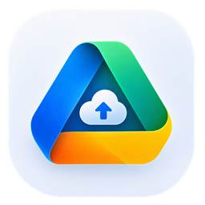

<div align="center">
  
  <h1>Teledrive</h1>
  <p>Seu cofre pessoal para organizar arquivos cifrados no Telegram.</p>
  <p>
    <a href="#downloads-do-teledrive"><strong>Windows</strong></a> ·
    <a href="#android"><strong>Android</strong></a> ·
    <a href="#instalação-local">Desenvolvimento</a> ·
    <a href="#publicação">Hospedagem</a>
  </p>
  <a href="https://github.com/Joaovictor18383/Tele-drive-/actions/workflows/checks.yml"></a>
</div>

## Downloads do Teledrive

| Plataforma | Download |
| --- | --- |
| Windows 10 e 11 · 64 bits | [TeledriveSetup.exe](https://github.com/Joaovictor18383/Tele-drive-/releases/latest/download/TeledriveSetup.exe) |
| Android 7 ou superior | [Teledrive-Android.apk](https://github.com/Joaovictor18383/Tele-drive-/releases/latest/download/Teledrive-Android.apk) |
| Navegador | [Abrir CloudVault Web](https://cloudvault-web-nu.vercel.app/) |

Na primeira vez, crie uma conta com nome e senha e autorize o Telegram neste dispositivo. Depois, entre com o nome e a senha do CloudVault. A senha mestra continua protegendo o cofre.

O instalador para PC abre a edição web em janela própria. Ele verifica atualizações assinadas e as aplica ao fechar. O APK usa a edição web e recebe atualização de interface pelo site. O Android pede confirmação para instalar novas versões do pacote. [Versão atual](https://github.com/Joaovictor18383/Tele-drive-/releases/latest)

## O que você pode fazer

| Arquivos | Privacidade | Acesso |
| --- | --- | --- |
| Envie arquivos e pastas, pesquise, organize favoritos e restaure itens da lixeira. | Arquivos e índice são cifrados no dispositivo antes do envio. | Acesse o mesmo cofre com a conta e as credenciais Telegram usadas na criação. |
| Veja fotos, vídeos, áudios, textos e PDFs. Baixe pastas em ZIP. | A senha mestra e a chave de recuperação são independentes da conta Telegram. | Use o aplicativo de Windows ou instale a edição web no Android. |

O CloudVault é um projeto independente que usa a API do Telegram. O espaço utilizado é calculado pelos arquivos do cofre e os limites do Telegram continuam aplicáveis.

## Edição clássica para Windows

**[Baixar a edição clássica para Mensagens Salvas](https://github.com/Joaovictor18383/Tele-drive-/releases/tag/v1.0.0)**

Abra `release/CloudVault.exe` no Windows 10 ou 11 de 64 bits com o Microsoft Edge WebView2 Runtime. O executável inclui a interface, a API local e o runtime do Node.js. A interface abre em uma janela própria do CloudVault. Na primeira execução, os componentes são extraídos para `%LOCALAPPDATA%\CloudVault`.

Na abertura, o executável permite continuar com a conta conectada ou conectar uma conta pelo QR. Para voltar a um cofre que já existe, escolha a conta do Telegram usada na sua criação e desbloqueie com a senha mestra. No primeiro uso, abra o portal oficial pelo assistente, copie as linhas **App api_id** e **App api_hash** em **API development tools** e use **Colar os dois valores**. O executável salva os dados no perfil local do Windows e exibe o QR oficial do Telegram. No celular, abra **Configurações → Dispositivos → Conectar dispositivo**. Se a conta tiver verificação em duas etapas, o Telegram pode solicitá-la.

Em **Meu Drive**, clique em **Enviar arquivos** e selecione os arquivos. Você pode fechar a janela da chave de recuperação e abrir essa chave pelo lembrete enquanto o cofre estiver aberto. Guarde a chave em local seguro.

O executável usa MTProto diretamente para confirmar a identidade. A instalação web descrita abaixo usa o fluxo com OIDC e QR. O arquivo `.env` ao lado do executável é opcional e, para configuração manual, aceita `TELEGRAM_API_ID`, `TELEGRAM_API_HASH` e `SESSION_KEY`.

Para atualizar o executável, feche o CloudVault e execute `npm ci` seguido de `npm run build:windows` em Windows x64 com o .NET Framework 4.8 e o WebView2 Runtime. O empacotamento testa a API e a interface na janela incorporada antes de substituir `release/CloudVault.exe`.

No GitHub, a ação [Publicar Windows](https://github.com/Joaovictor18383/Tele-drive-/actions/workflows/windows.yml) também gera o executável e o SHA-256. Para criar uma nova prévia em Releases, atualize a versão em `package.json` e `package-lock.json` e rode a ação em `main` com `publish` marcado.

## Android

O APK oficial deste repositório está disponível na seção de downloads. Ele usa o cofre dedicado da edição web, que é separado do cofre em Mensagens Salvas da edição clássica.

## Instalação local

Use Node.js 22.13 ou superior, npm, um navegador moderno e uma conta no Telegram.

1. Instale as dependências.

   ```sh
   npm ci
   ```

2. Copie `.env.example` para `.env`. No PowerShell, use `Copy-Item .env.example .env`.
3. Configure as credenciais abaixo e gere uma chave de sessão.

   ```sh
   node -e "process.stdout.write(require('node:crypto').randomBytes(32).toString('hex') + '\n')"
   ```

4. Inicie a interface e a API.

   ```sh
   npm run dev
   ```

5. Abra [http://localhost:5173](http://localhost:5173). A API escuta internamente em `127.0.0.1:3000` e o Vite encaminha `/api/*`. Para usar outra porta no desenvolvimento, atualize também o destino do proxy em `vite.config.ts`.

Sem credenciais, o ambiente de desenvolvimento exibe a tela de entrada e indica a configuração necessária. A API inicia em produção apenas com credenciais válidas e uma origem HTTPS.

## Telegram

1. Entre em [my.telegram.org](https://my.telegram.org) e abra **API development tools**. Registre sua própria aplicação. Copie o App API ID para `TELEGRAM_API_ID` e o App API Hash para `TELEGRAM_API_HASH`. Trate o hash como segredo. [Instruções oficiais](https://core.telegram.org/api/obtaining_api_id).
2. No [@BotFather](https://t.me/BotFather), crie o bot que representa sua aplicação. Em **Login Widget → Allowed URLs**, cadastre a origem usada no navegador e o callback exato. Para produção, use por exemplo `https://vault.seudominio.com` e `https://vault.seudominio.com/api/auth/callback`. Cadastre também os URLs locais quando o BotFather aceitar a origem de desenvolvimento. Uma origem de testes HTTPS com certificado válido também serve para validar o fluxo completo.
3. Defina `TELEGRAM_OIDC_CLIENT_ID` e `TELEGRAM_OIDC_CLIENT_SECRET` com as credenciais fornecidas pelo BotFather. Mantenha a assinatura de token em RS256 ou ES256. Defina `PUBLIC_ORIGIN` com a origem cadastrada e `SESSION_KEY` com os 64 caracteres hexadecimais gerados no passo anterior. [Documentação oficial do Telegram Login](https://core.telegram.org/bots/telegram-login).
4. Selecione **Conectar com Telegram**. Depois do retorno do login oficial, leia as permissões MTProto e gere o QR. No app oficial, vá a **Configurações → Dispositivos → Conectar Dispositivo** e escaneie usando a mesma conta. Use outro dispositivo ou outra tela para exibir o QR. Se a API do Telegram exigir a senha de duas etapas, o navegador calcula a prova SRP localmente. [Autorização por QR](https://core.telegram.org/api/qr-login) · [Verificação SRP](https://core.telegram.org/api/srp).
5. Crie o cofre, guarde a chave de recuperação e envie um arquivo pequeno. Depois, conecte em outro navegador e confira se a estrutura foi restaurada. Baixe o arquivo e compare sua integridade. Em **Configurações → Sessões CloudVault**, você pode revogar autorizações deste aplicativo.

**A sessão MTProto concede acesso amplo à conta Telegram.** O CloudVault restringe suas próprias operações a registros assinados criados nas Mensagens Salvas, à verificação de identidade e à gestão das próprias autorizações. A posse da sessão pode permitir a um terceiro agir com as permissões da conta. Em uma instalação compartilhada, confie em quem controla o servidor e a origem que entrega o JavaScript.

**Guarde a chave de recuperação fora do dispositivo.** A perda da senha mestra e dessa chave pode tornar os arquivos inacessíveis de forma definitiva. A alteração de senha protege os acessos futuros pela interface. Um dispositivo que já possua a chave raiz ou backups das antigas chaves encapsuladas pode continuar a descriptografar os dados correspondentes. Para desconectar, bloquear ou revogar dispositivos, use as ações da página de configurações ou os controles de autorização do Telegram.

## Desenvolvimento e testes

```sh
npm run typecheck
npm test
npm run build
npm start
```

O build gera o frontend em `dist/web` e a API em `dist/server.mjs`. Para testar a PWA localmente com `npm start`, use a origem local que corresponde à porta da API, por exemplo `PUBLIC_ORIGIN=http://localhost:3000`. A instalação acontece pelo menu do navegador compatível ou pelo botão do CloudVault quando o navegador disponibiliza o convite. O service worker armazena os recursos estáticos da aplicação. Os registros em IndexedDB contêm o índice cifrado e os parâmetros criptográficos públicos. Em uma abertura sem rede, a verificação inicial de sessão precisa do servidor.

Os testes cobrem encapsulamento e recuperação de chaves, adulteração, AAD, integridade dos blocos, assinatura e claims do Telegram, PKCE, sessão cifrada, origem das requisições, partes consecutivas, reenvio idempotente e limites MTProto. Os testes automatizados usam chaves geradas durante a execução e um transporte de teste. Para validar o provedor de ponta a ponta, repita o fluxo acima com uma origem registrada e uma conta autorizada. Teste também uma conta com verificação em duas etapas, um arquivo vazio, envio grande com pausa e ZIP de uma pasta com subpastas.

## Arquitetura

| Diretório | Responsabilidade |
| --- | --- |
| `src/ui` | Acesso, painel, visualizador, configurações e fila de transferências |
| `src/lib` | Web Crypto, Argon2id, Web Workers, cache IndexedDB e operações de arquivo |
| `server` | Fastify, OpenID Connect, sessões protegidas e integração GramJS |
| `shared` | Esquemas validados, formato de transferência e operações do índice |
| `tests` | Testes automatizados de criptografia, login e transferência |

- Cada upload cria uma chave AES-256-GCM aleatória. O nonce de cada bloco combina um prefixo aleatório com o número do bloco. A autenticação vincula o conteúdo à identidade do arquivo, posição e tamanho total. Os downloads completos também validam o SHA-256 do conteúdo.
- O navegador usa Argon2id com 64 MiB de memória, três iterações e paralelismo 1. A senha mestra e a chave de recuperação encapsulam a chave raiz aleatória. O índice usa operações cifradas que o cliente aplica em ordem de mensagem. O serviço vê ciphertext, tamanhos, atividade e identificadores técnicos. Nomes, chaves de arquivo e metadados do cofre ficam dentro dos registros cifrados.
- Cada parte cifrada tem até 512 KiB e segue diretamente da API Fastify ao Telegram. O servidor mantém apenas a parte em trânsito e o estado temporário necessário para a retomada. O arquivo remoto usa um nome aleatório com extensão `.enc`. Não há serviço externo para armazenar arquivos.
- O Telegram define limites por arquivo, frequência e velocidade. O CloudVault consulta o limite da conta e trata `FLOOD_WAIT`. Pausas preservam o progresso enquanto a aba, o processo e as partes temporárias do Telegram continuarem disponíveis. Após expiração, o envio recomeça.
- Downloads grandes usam streaming via seletor de destino quando disponível ou service worker nos navegadores compatíveis. Downloads em memória têm limite de 64 MiB. A visualização por Blob tem limite de 64 MiB, com 2 MiB para texto. Áudio e vídeo maiores podem ser lidos por faixas autenticadas com service worker ativo. A reprodução depende dos codecs do navegador. PDFs são renderizados localmente via PDF.js sem interação com conteúdo ativo.
- O Telegram pode remover ou indisponibilizar mensagens. Mantenha uma cópia independente dos arquivos importantes. A exclusão permanente remove o documento cifrado das Mensagens Salvas. O histórico operacional cifrado do índice mantém as alterações de metadados para sincronização.

## Publicação

Use um servidor com **conexões TCP de saída para o Telegram**, HTTPS na origem pública e um volume persistente para sessões. O Dockerfile executa a aplicação como usuário sem privilégios. Use apenas uma instância da API por volume e origem. Transações OIDC, QR e uploads ativos mantêm estado em memória e dependem da mesma instância.

```sh
docker build -t cloudvault .
docker run -d --name cloudvault --restart unless-stopped --env-file .env \
  -e SESSION_DIR=/data/sessions -p 127.0.0.1:3000:3000 \
  -v cloudvault-sessions:/data cloudvault
```

Coloque Nginx, Caddy ou outro proxy TLS na frente do contêiner e encaminhe todas as rotas para `127.0.0.1:3000`. Permita corpos de pelo menos 1 MiB e tempos de resposta superiores a 45 segundos. Coloque a origem HTTPS real em `PUBLIC_ORIGIN` e registre o callback exato no BotFather. Use uma política de acesso e backup para o volume. Guarde `SESSION_KEY` e `TELEGRAM_API_HASH` em um gerenciador de segredos. A troca de `SESSION_KEY` exige reconexão das sessões afetadas. O API Hash original autentica os marcadores nas Mensagens Salvas e é necessário para reconhecer os registros em instalações futuras. Monitore `GET /api/health`.

### Revisão dos termos

A revisão abrangeu os controles de privacidade, consentimento informado, credenciais próprias, transparência da integração, identidade visual independente e limites de uso. Como o CloudVault oferece um cliente especializado em armazenamento, a cláusula 1.3 sobre os recursos básicos dos aplicativos principais do Telegram deixa uma questão de elegibilidade para distribuição pública. Confirme com o Telegram a aplicação dessa cláusula a este caso de uso antes de oferecer o serviço ao público. O projeto usa GramJS conforme solicitado. O pacote npm está arquivado, portanto considere esse estado na revisão de manutenção e segurança anterior a qualquer distribuição. [Termos da API](https://core.telegram.org/api/terms) · [Limites de arquivos](https://core.telegram.org/api/files) · [Configuração do cliente](https://core.telegram.org/api/config) · [Pacote GramJS](https://www.npmjs.com/package/telegram).
